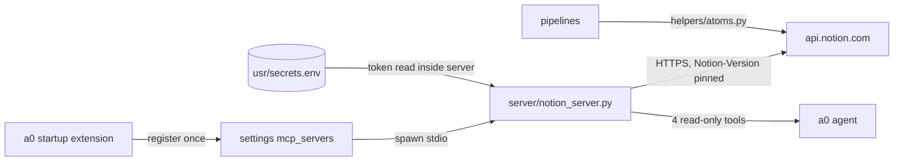

<p align="center">
  <picture>
    <source media="(prefers-color-scheme: dark)" srcset="assets/brand/wordmark-dark.svg">
    
  </picture>
</p>

Read-only Notion access for [Agent Zero](https://github.com/agent0ai/agent-zero) using an integration token from the a0 secrets vault, with no OAuth step.

Status: v0.1.0, disabled by default, inert until enabled. See [ROADMAP.md](ROADMAP.md).

The agent gets `notion_search`, `notion_get_page`, `notion_get_page_content` and `notion_query_database` through a bundled local stdio MCP server. A separate ingestion path (`notion://` URIs and `.notion.json` exports) emits atoms for knowledge pipelines. Ported from the Khan fork's `connectors/notion.py`; no upstream edits.

<!-- TODO: screenshot of the settings panel from a running a0 -->

## How it works



## Install

Drop the repo contents into `usr/plugins/notion/` (the directory name is the
plugin name — imports and `/api/plugins/notion/*` routes key on it; the repo
is `a0-plugin-notion` but the install path must be `notion`).

## Quick start (two steps)

1. Create a [Notion integration](https://www.notion.so/profile/integrations),
   copy the internal token (`ntn_…`), and share the pages/databases you want
   a0 to reach with that integration.
2. Add `NOTION_TOKEN=ntn_…` to the **a0 secrets vault** (Settings → Secrets —
   backed by `usr/secrets.env`; `usr/.env` works too — the server resolves
   both, same as `§§secret()`), or export `NOTION_TOKEN` in the spawned
   server's environment.

Set `enabled: true` in the plugin config and restart — the plugin registers
`a0_notion` in `settings["mcp_servers"]` (idempotent, preserves your other
servers) and a0 spawns `server/notion_server.py` with the same Python it
runs on. `hooks.py uninstall` removes the entry.

## Why a local MCP server (the tradeoff)

Notion runs an official remote MCP at `mcp.notion.com`. Choosing a bundled
local server was deliberate. Notion's [overview](https://developers.notion.com/docs/mcp)
describes OAuth authorization only; one third-party post
([Scalekit](https://scalekit.com/blog/notion-mcp-vs-api)) states it is
OAuth-only and not designed for headless agents. That is a single source;
check Notion's docs before relying on it. Details in
[docs/research/2026-10-10-landscape.md](docs/research/2026-10-10-landscape.md).

| | remote `mcp.notion.com` | local stdio (this plugin) |
|---|---|---|
| Auth | OAuth 2.0 flow — interactive browser consent per workspace | Integration token from the vault — headless, no OAuth dance |
| Runs on | Notion-hosted, always current | Your box — air-gapped tailnets work |
| Surface | Full read+write surface Notion ships | Read-only by design — fewer blast radius for a token-bearing agent |
| Latency | Remote round-trip per call | Local process; Notion API still remote but no OAuth/session overhead |
| Deps | Needs OAuth-capable MCP client | `mcp` SDK — already an a0 dependency |

If you prefer the remote server, add it under `mcp_servers` yourself and set
`auto_register_mcp: false` — this plugin's tools and theirs can coexist.

## How the token stays out of settings.json

a0's stdio spawn passes a **safe-listed environment** plus the static `env`
dict from the `mcp_servers` entry. The entry's `env` therefore carries only
non-secret config (`NOTION_SECRET_NAME`, `NOTION_API_VERSION`, result caps) —
never `NOTION_TOKEN`, which would sit plaintext in settings.json.
Instead the spawned server resolves the token *inside its own process*:

1. `NOTION_TOKEN` (or `secret_name`) in the spawned server's env — covers
   standalone runs and operators who inject secrets another way.
2. `usr/secrets.env`, then `usr/.env` — the same files `§§secret(NOTION_TOKEN)`
   resolves against; the server self-locates the a0 root from `__file__`.

So the vault stays the single source of truth and settings.json only ever
holds `{type: stdio, command, args, env: non-secret config}` — no secrets.

## Tools

| tool | what it does |
|---|---|
| `notion_search(query, filter_object?, page_size?)` | Workspace search; `filter_object` = `page`/`database` |
| `notion_get_page(page_id)` | Metadata + compacted property values |
| `notion_get_page_content(page_id, max_blocks?)` | Block tree flattened to readable text (headings, lists, code, tables, todos) |
| `notion_query_database(database_id, filter_json?, page_size?)` | Rows as page summaries; `filter_json` = raw Notion filter object |

Read-only — there is intentionally no create/update/delete tool.

## Ingestion atoms

`helpers/atoms.py` ports Khan's contract for pipelines (Kurultai #200,
device-sync's kurultai inbox):

- `notion://database/<id>` → live query → atoms
- `…/<name>.notion.json` → cached export → atoms
- `page_to_atom(page, source)` → the flat `{id,title,content,tags,source,extra}` shape

Bulk/scheduled sync is deliberately out of scope — schedule a job that calls
these helpers rather than hammering the API from agent tools.

## Config

`default_config.yaml` documents every key; env overrides use the `NOTION_*` prefix.

| Key | Default | Env | Meaning |
|---|---|---|---|
| `enabled` | `false` | `NOTION_ENABLED` | Master switch; plugin is inert until true |
| `secret_name` | `NOTION_TOKEN` | `NOTION_SECRET_NAME` | Vault key holding the token. Selects any vault key, so keep it a `NOTION_*` name |
| `api_version` | `2022-06-28` | `NOTION_API_VERSION` | `Notion-Version` header |
| `http_timeout_s` | `30` | `NOTION_HTTP_TIMEOUT_S` | HTTP timeout for Notion calls |
| `max_search_results` | `25` | `NOTION_MAX_SEARCH_RESULTS` | Cap per search or database query call |
| `max_page_blocks` | `500` | `NOTION_MAX_PAGE_BLOCKS` | Cap per page-content read |
| `auto_register_mcp` | `true` | `NOTION_AUTO_REGISTER_MCP` | Register the server in `mcp_servers` at startup |

## Diagnostics

`POST /api/plugins/notion/notion_status` → `{enabled, secret_name,
token_present, mcp_registered, server_name}` — session-auth'd like a normal
a0 API; never echoes the token.

## Tests

```bash
python -m pytest tests/ -q
```

Standalone — the Notion API is faked at the `urlopen` seam, the MCP SDK is
stubbed where needed, no network, no token.

## Limits

- The integration only sees pages explicitly shared with it — that's
  Notion's model, not a plugin limit.
- `child_page`/`child_database` blocks appear as `[page]`/`[database]`
  stubs in `get_page_content` — open them with their own ids (one fetch
  level per call keeps responses bounded); table rows and toggle contents
  likewise appear as `[table]`/`▸` stubs.
- `.notion.json` ingestion reads local exports — URIs are operator-trusted
  (no directory confinement); don't point it at untrusted paths.
- Disabling the plugin (`enabled: false`) unregisters the MCP entry on the
  next `configure()`; the a0 plugin toggle (which skips plugin code) leaves
  it — delete `a0_notion` from MCP servers to fully remove it.
- API surface is pinned to `Notion-Version: 2022-06-28` (config-overridable
  when Notion's dated API moves).

## Status and roadmap

See [ROADMAP.md](ROADMAP.md) and the [program plan](docs/plans/2026-10-10-002-notion-program-roadmap-plan.md). Design direction: [DESIGN.md](DESIGN.md).

## Contributing

Read [AGENTS.md](AGENTS.md) first: the plugin is read-only by contract, and adding write tools needs an issue-level decision. Run `python -m pytest tests/ -q` before opening a pull request.

## Licence

MIT, see [LICENSE](LICENSE) and [NOTICE](NOTICE).
